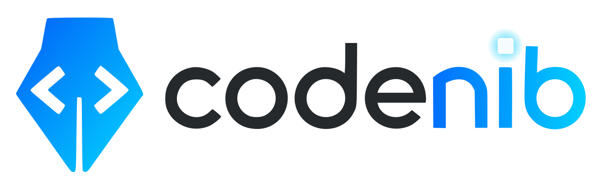
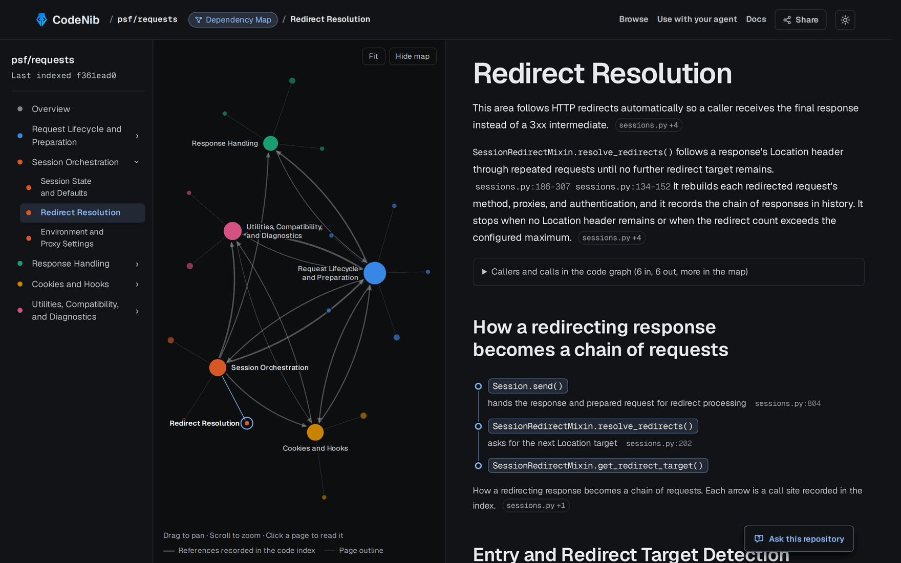
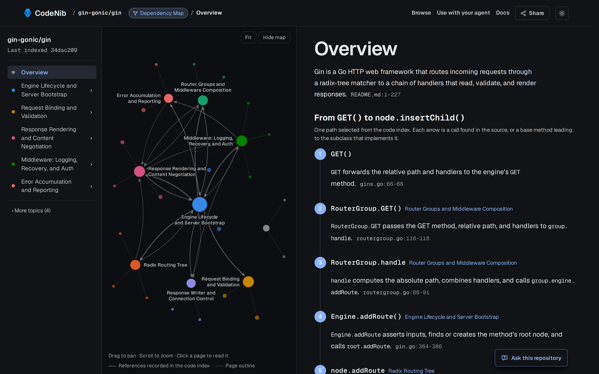
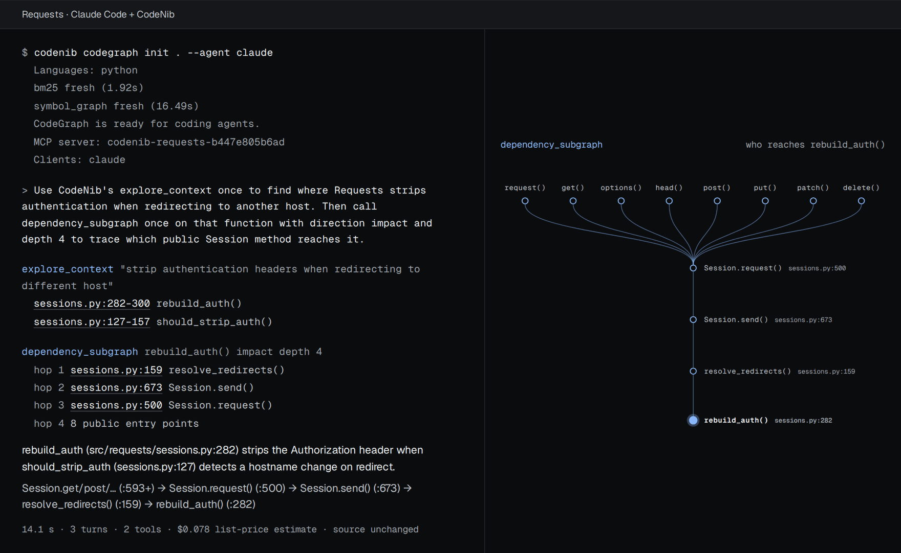

<!--
SPDX-FileCopyrightText: 2025-2026 CodeNib Contributors

SPDX-License-Identifier: Apache-2.0
-->
<!-- mcp-name: ai.codenib/codenib -->

<div align="center">
  
  <h1>Understand unfamiliar code with evidence.</h1>
  <p>
    Read a Wiki of how a repository works, follow its call paths on a map,
    and open the source behind every explanation.<br>
    Then give your coding agent the same index.
  </p>
  <p>
    <a href="https://demo.codenib.ai"><strong>Browse a Wiki</strong></a>
    &nbsp;&middot;&nbsp;
    <a href="#use-it-with-your-coding-agent">Use with your agent</a>
    &nbsp;&middot;&nbsp;
    <a href="https://docs.codenib.ai/">Docs</a>
    &nbsp;&middot;&nbsp;
    <a href="https://docs.codenib.ai/language_capabilities/">Languages</a>
    &nbsp;&middot;&nbsp;
    <a href="https://github.com/sysevol-ai/CodeNib/releases">Releases</a>
  </p>
  <p>
    <a href="https://github.com/sysevol-ai/CodeNib/actions/workflows/ci-full.yml"></a>
    <a href="https://pypi.org/project/codenib/"></a>
    <a href="https://github.com/sysevol-ai/CodeNib/releases/latest"></a>
    <a href="https://arxiv.org/abs/2607.25431"></a>
    <a href="https://huggingface.co/papers/2607.25431"></a>
    <a href="https://github.com/sysevol-ai/CodeNib/blob/main/LICENSE"></a>
  </p>
  <p>
    <a href="https://docs.codenib.ai/codegraph/#claude-code-plugin"></a>
    <a href="#use-it-with-your-coding-agent"></a>
    <a href="https://docs.codenib.ai/codegraph/#grok-build-plugin"></a>
    <a href="https://docs.codenib.ai/codegraph/#deepseek-harness-bundle"></a>
    <a href="https://github.com/marketplace/actions/codenib-wiki"></a>
  </p>
</div>

<p align="center">
  <a href="https://demo.codenib.ai/psf__requests?p=redirects">
    
  </a>
</p>
<p align="center"><sub>
  The <a href="https://demo.codenib.ai/psf__requests?p=redirects">Requests Wiki</a>.
  Each node on the map is a page, and the heavy lines are references the code
  index recorded between areas. The page cites a file and line range for each claim.
</sub></p>

New in **0.2.6**: Wikis open as a map of their pages and lead with the main path
through the code, faster graph builds, and first C/C++ and JavaScript/TypeScript
builds that leave the checkout alone.
[Read the release notes](https://docs.codenib.ai/releases/0.2.6/).

## A Wiki you can follow down to the source

CodeNib indexes a repository, groups its code into areas, and writes a Wiki
page for each one. The map and the call paths come from the code index, so you
can check every arrow against the source.

- **Start from the map.** Pages are nodes. Drag to pan, scroll to zoom, and
  click a node to read its page. Click a heavy line to read an example of the
  references behind it.
- **Follow one path through the code.** The Overview opens on the main path
  through the repository, one sentence per recorded call. The most important
  detail pages draw their longest recorded call path. No model chooses the
  arrows.
- **Check each claim.** Sentences end with the file and line range they come
  from, and each page lists its callers and calls in the code graph.
- **Ask a follow-up.** *Ask this repository* answers a question with source
  citations, using the model you configure.

<p align="center">
  <a href="https://demo.codenib.ai/gin-gonic__gin">
    
  </a>
</p>
<p align="center"><sub>
  The <a href="https://demo.codenib.ai/gin-gonic__gin">gin Wiki</a> opens on one
  recorded path, from <code>GET()</code> to <code>node.insertChild()</code>.
</sub></p>

### Open a Wiki

| To | Do this |
| --- | --- |
| Read one now | Open a [ready Wiki](https://demo.codenib.ai/browse) for requests, scikit-learn, sympy, fmt, redis, caddy, gin, hugo and more. No account or API key. |
| Map a public GitHub repository | Paste its URL on [demo.codenib.ai](https://demo.codenib.ai), or replace `github.com` with `demo.codenib.ai` in the URL. A new Wiki uses your OpenRouter account, with a $0.25–$5 spending limit you set before it starts. |
| Map your own checkout | Run the Wiki locally, as below. |
| Share it | Publish the Wiki, with its source citations, to GitHub Pages: add the [CodeNib Wiki action](https://github.com/marketplace/actions/codenib-wiki) to a workflow. [Pages guide](https://docs.codenib.ai/github_pages/) |

To build a Wiki with the map on your machine:

```bash
python -m pip install "codenib[graph]"
codenib wiki /path/to/your/repo --preset graph
```

This builds a search index and a symbol graph, then opens the Wiki at
`http://localhost:3000`. Pages are written from the index without a model.
Add `--generate --model <provider/model>` for model-written pages.
[Local Wiki guide](https://docs.codenib.ai/quickstart/)

<a id="quickstart"></a>

## Use it with your coding agent

Build the same index for Claude Code or Codex. Your agent can then find
definitions, follow callers and read the source in your own checkout.

<p align="center">
  <a href="https://codenib.ai/#get-started">
    
  </a>
</p>
<p align="center"><sub>
  One recorded Claude Code session on Requests: 14.1 s, 3 turns, 2 CodeNib tools.
  <a href="https://codenib.ai/#get-started">▶ Watch it replay</a> ·
  <a href="https://docs.codenib.ai/codegraph/#recorded-agent-session">Pinned source, transcript and setup details</a>
</sub></p>

Requires Python 3.10+, Git, and Claude Code or Codex. Initialization accepts
uncommitted edits and preserves the checkout.

```bash
python -m pip install "codenib[graph,mcp]"
codenib codegraph init /path/to/your/repo
```

Then ask your agent: **“Use CodeNib's `explore_context` to find where request
retry behavior is implemented. Cite the files and lines.”**

This builds local search and a typed symbol graph, then connects installed
agent clients. CodeNib needs no model, API key, or GPU of its own; your agent
uses its own model. Language toolchain and project prerequisites vary.

In Claude Code you can install the plugin instead. It connects every Git
checkout you open and adds `/codenib:explain`, `/codenib:impact`,
`/codenib:setup` and `/codenib:wiki`:

```bash
claude plugin marketplace add sysevol-ai/CodeNib
claude plugin install codenib@codenib
```

Grok Build reads the same plugin, and DeepSeek Harness installs it as a bundle:

```bash
grok plugin install "sysevol-ai/CodeNib#plugins/codenib"
dsh plugin --profile web add "git+https://github.com/sysevol-ai/CodeNib.git#main&path:/plugins/dsh"
```

[Grok Build setup](https://docs.codenib.ai/codegraph/#grok-build-plugin)
· [DeepSeek Harness setup](https://docs.codenib.ai/codegraph/#deepseek-harness-bundle)

[Setup and troubleshooting](https://docs.codenib.ai/codegraph/)
· [Source exclusions](https://docs.codenib.ai/codegraph/#select-the-repository-source-surface)
· [All MCP tools](https://docs.codenib.ai/mcp/)
· [Change guard](https://docs.codenib.ai/guard/) (preview, Python: lists the tests a change reaches before your agent finishes)

## How it compares

What an agent can ask each tool. Peer interfaces were checked against upstream
docs on 2026-09-28. This compares capabilities, not benchmark scores.

| Tool | Ask in plain language | Relationships beyond one hop | Relationships resolved by | Runs |
| --- | --- | --- | --- | --- |
| grep / read | No; literal or regex | No | Text match | Local |
| **CodeNib CodeGraph** | Yes; ranked source anchors (`explore_context`) | Incoming/outgoing static references; one `dependency_subgraph` call, depth ≤ 8 | SCIP/LSP indexers (compiler-resolved) | Local |
| [Serena](https://github.com/oraios/serena) | No; symbol name or regex | One level per call (`find_referencing_symbols`) | Live language server or IDE | Local |
| [CodeGraph (colbymchenry)](https://github.com/colbymchenry/codegraph) | Yes; FTS5 full-text (`codegraph_explore`) | Yes; call paths in `codegraph_explore` | Tree-sitter AST extraction | Local; telemetry opt-out |
| [DeepWiki public MCP](https://docs.devin.ai/work-with-devin/deepwiki-mcp) | Yes; generated answers (`ask_question`) | No structured graph tools | Generated Wiki | Hosted |

CodeNib's indexed references can include calls, fields, type uses and function
values. Inspect the source to establish which references invoke a function;
external and dynamic relationships may be missing. For a known string or file,
your agent's native search and reads remain useful. Include indexing and rebuild
costs when assessing graph navigation on your own tasks.

None of these repository tools needs its own model or API key; your agent
uses its own model. [Detailed comparison, sources and boundaries](https://docs.codenib.ai/comparison/).
CodeNib also includes an optional [grep → Jev route](https://docs.codenib.ai/guides/grep-jev/)
using OpenRouter for planning and reranking; selected code goes to remote
models. Authorization previews remain opt-in.

## Languages

CodeNib registers 14 languages, 12 of them with a code graph.

| Support | Languages |
| --- | --- |
| Code graph with an incremental backend (LSP or clangd) | Python, Go, Rust, C/C++, JavaScript, TypeScript |
| Code graph | C#, Java, Ruby, PHP, Kotlin, Scala |
| Search only, no definitions or callers | Swift, Lua |

These are registered capabilities, not the tools on your machine;
`codenib toolchain status` shows those. The product currently reuses or
rebuilds views; file-level delta repair is not enabled. The
[language matrix](https://docs.codenib.ai/language_capabilities/) lists each
backend and its prerequisites.

## Results and reproductions

- **#1 in line recall and Pass@1 on ContextBench's Agent systems leaderboard**:
  77.90% line recall and 388 of 500 tasks resolved (77.60% Pass@1), as of
  October 23, 2026 (UTC). This is our research agent, not the Wiki or the code
  graph: two Claude Haiku 5.5 workers search with glob, grep and reads, then
  Claude Opus 5.5 repairs.
  [How it works](https://codenib.ai/blogs/contextbench-500-tasks/)
  · [Scope and evidence](https://codenib.ai/blogs/contextbench-500-tasks/#scope)
- **71.4% code-block Recall@5 on 100 real issues** with model-planned
  grep → Jev, 12.8 percentage points above the same grep candidates without
  reranking. This is an experimental retrieval route, separate from the
  model-free CodeGraph.
  [Method and limitations](https://docs.codenib.ai/evaluation/grep_jev/)

| Start here | What you can inspect |
| --- | --- |
| [Context methods and support matrix](https://docs.codenib.ai/concepts/methods/) | Every retrieval pipeline, LLM workflow and agent route, sorted by the views it reads and who controls the search |
| [Benchmarks](https://docs.codenib.ai/evaluation/) | Localization, agent-context and resolution layers, evidence levels, and the method × benchmark matrix over CodeNib Base/Synthesis, SWE-bench Lite, Loc-Bench, SWE-Explore, Agent Retrieval Bench and ContextBench |
| [Agent integration matrix](https://docs.codenib.ai/agent_integrations/) | Revision-pinned LocAgent, Agentless, CoSIL, OrcaLoca and RepoNavigator contracts; compatibility does not imply reproduced paper scores |
| [SWE-Explore validation](https://docs.codenib.ai/evaluation/swe_explore/) | 1,020/1,020 real-output metric cells match the pinned official evaluator on a fixed 20-case run |
| [DGX Spark deployment](https://docs.codenib.ai/guides/reference-deployments/dgx-spark/) | Local Wiki, CodeGraph and model serving on GB10; a deployment guide, not a token-saving benchmark |

## Documentation and community

[Documentation](https://docs.codenib.ai/)
· [Architecture](https://docs.codenib.ai/concepts/architecture/)
· [Contributing](https://github.com/sysevol-ai/CodeNib/blob/main/CONTRIBUTING.md)
· [CI and testing](https://docs.codenib.ai/ci_cd/)
· [Changelog](https://github.com/sysevol-ai/CodeNib/blob/main/CHANGELOG.md)
· [Discord](https://discord.com/invite/AtrukE7Jpx)

CodeNib is in beta; public interfaces may change before a stable release.
Historical research artifacts retain their published dataset identifiers.

## Citation

If you use CodeNib in your research, please cite our
[arXiv paper](https://arxiv.org/abs/2607.25431):

```bibtex
@misc{yu2026codenibmultiviewdataserving,
      title={CodeNib: A Multi-View Data System for Serving Repository Context to Coding Agents},
      author={Zhongming Yu and Hengjia Yu and Boqin Yuan and Shuting Zhao and Yizhao Chen and Aryan Dokania and Mihir Jagtap and Jiayu Chang and Yitong Ma and Yash Jayswal and Wentao Ni and Hejia Zhang and Zhaoling Chen and Gangda Deng and Jishen Zhao},
      year={2026},
      eprint={2607.25431},
      archivePrefix={arXiv},
      primaryClass={cs.SE},
      url={https://arxiv.org/abs/2607.25431},
}
```

CodeNib is licensed under [Apache 2.0](https://github.com/sysevol-ai/CodeNib/blob/main/LICENSE).
